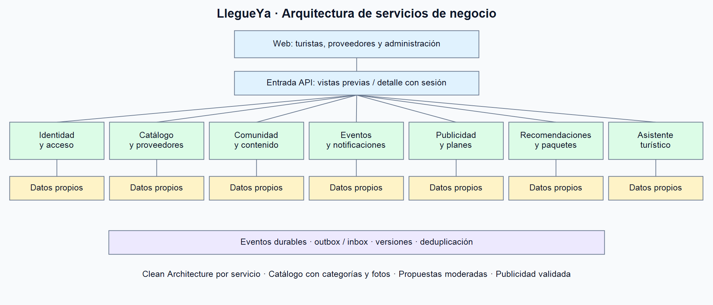

# Servicios y componentes arquitectónicos de LlegueYa

[Diagrama vectorial](../img/componentes-arquitectonicos.svg). La imagen presenta contenedores y datos de C2-A, no componentes internos de C3. La tabla siguiente cataloga responsabilidades internas por servicio. [C3 de Publicidad](../../modelo-c4/Nivel3-DiagramadeComponentes.md) amplía un único contenedor.

| Servicio | Componentes principales | RF |
|---|---|---|
| Identidad y acceso | Sesión, registro, roles y validación de credenciales. | RF01, RF46, RF53 |
| Catálogo y proveedores | Destinos, actividades/camping, propuestas de lugares, negocios, categorías/estrellas/tenedores, verificación, ofertas/paquetes, favoritos y galerías. | RF02-RF05, RF17-RF19, RF26, RF36, RF37, RF48-RF50, RF52, RF53 |
| Comunidad y contenido | Experiencias, reseñas, comentarios/respuestas en hilos, likes en fotos/comentarios, reportes, moderación y contenido cultural. | RF06-RF12, RF20-RF25, RF50, RF55-RF59 |
| Eventos y notificaciones | Propuestas de eventos, revisión, calendario, suscripciones, bandeja y ejecutores. | RF12, RF27-RF29, RF40, RF50, RF51, RF55 |
| Publicidad y planes | Gratuidad, planes, pagos revisados, campañas sobre distintos objetivos, selección y métricas. | RF30-RF33, RF38-RF45, RF54, RF55 |
| Recomendaciones y paquetes | Compatibilidad, cálculo familiar y propuestas guardadas. | RF13, RF34, RF47 |
| Asistente turístico | Conversación, contexto autorizado, recuperación de conocimiento y adaptador de IA. | RF14-RF16, RF35, RF45, RF47, RF53 |

Cada servicio contiene presentación, aplicación, dominio e infraestructura. La entrada API enruta; el servicio valida autorización. Los componentes de servicios distintos usan contratos públicos o eventos, no tablas compartidas.

[Diagrama lógico](../04-especificacion-funcional/02-arquitectura-y-diseno.md#2-vista-lógica), [contenedores C4](../../modelo-c4/Nivel2-DiagramadeContenedores.md) y [componentes de Publicidad](../../modelo-c4/Nivel3-DiagramadeComponentes.md).

Las portadas aprobadas son públicas; galerías del detalle requieren sesión. Expedientes, comprobantes y originales pendientes son privados. Catálogo gestiona evidencia de categorías; Eventos, fotos de sus propuestas; Comunidad, fotos de viajeros. La distribución de archivos respeta esas políticas.
