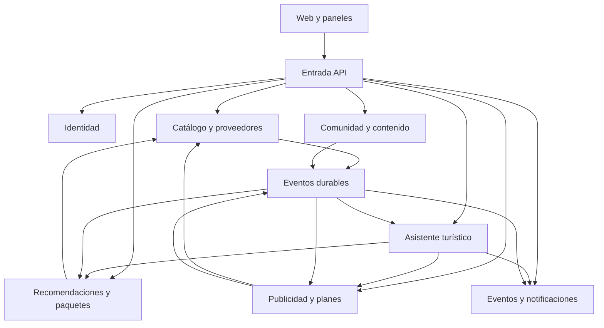

# Estilo arquitectónico

## Estilo seleccionado

**Arquitectura distribuida orientada a servicios de negocio**, con despliegues independientes, consultas REST y propagación de cambios por eventos durables. Cada servicio tiene límites de responsabilidad, datos y despliegue propios.

| Elemento | Decisión de LlegueYa |
|---|---|
| Despliegue | Siete servicios independientes detrás de una entrada API estable. |
| Servicios | Identidad; Catálogo y proveedores; Comunidad y contenido; Eventos y notificaciones; Publicidad y planes; Recomendaciones y paquetes; Asistente turístico. |
| Diseño interno | Clean Architecture en cada servicio; dominio sin dependencias de red o framework. |
| Datos | Propiedad exclusiva por servicio; bases/esquemas y credenciales aislados, sin acceso a tablas ajenas. |
| Comunicación | REST con autorización para consultas; eventos durables con outbox e idempotencia para cambios. |
| Lecturas y fotos | Vistas previas públicas, detalle autenticado, paginación y entrega de imágenes según permisos. |
| Escalamiento | Cada servicio puede replicarse según su demanda, sin desplegar todos los demás. |
| Fallos | Límites de tiempo, reintentos acotados y degradación de IA/publicidad sin detener consultas independientes. |

## Diagrama

[Diagrama editable Draw.io](estilo-arquitectonico.drawio) y [vista HTML](estilo-arquitectonico.html).

## Reglas y consecuencias

Cada servicio mantiene sus transacciones y valida permisos. Cambios de estado se propagan mediante eventos versionados, reintentables y deduplicados. Proyecciones y cachés no habilitan proveedores suspendidos: las nuevas entregas publicitarias se revalidan contra Catálogo. El periodo gratuito y los pagos pertenecen a Publicidad, no a Identidad ni al modelo de IA.

La distribución implica latencia de red, fallos parciales, operación por servicio y consistencia eventual. Los siete servicios se agrupan por capacidad de negocio y exponen contratos versionados.

Detalle: [arquitectura y diseño](../04-especificacion-funcional/02-arquitectura-y-diseno.md). Las vistas Mermaid de los documentos describen el sistema. Stack e infraestructura se definirán al implementar.
