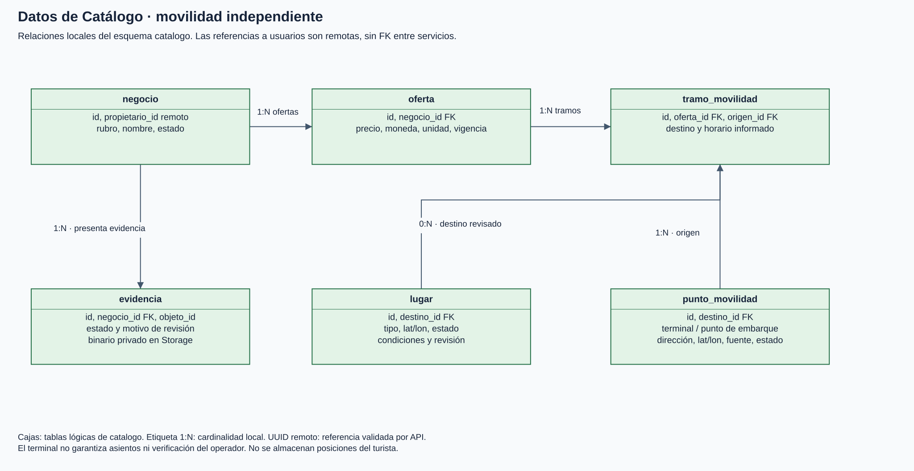
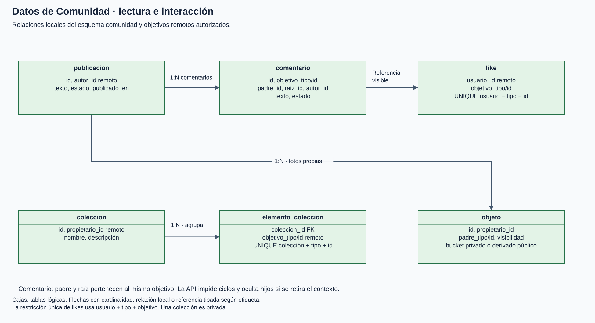
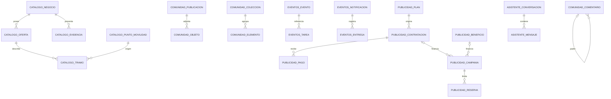

# 04 · Modelo de datos y Supabase

[Índice](README.md) · [Anterior](03-servicios-capas-y-solid.md) · [Siguiente](05-contratos-e-integraciones.md)

## 4.1 Convenciones y propiedad

Una base PostgreSQL gestionada por Supabase contiene siete esquemas privados de negocio. Se usan UUID para identificadores; `timestamptz` para instantes UTC; `date` para fecha civil; importes `numeric(12,2)` y moneda ISO; coordenadas WGS84 `numeric(9,6)`; estados con valores cerrados; `version bigint` para concurrencia. Una referencia `usuario_id` o `negocio_id` remota es un UUID sin FK entre esquemas. Dentro del mismo esquema se usan FK y restricciones locales. Los campos enumerados constituyen el diccionario lógico inicial; longitudes y validaciones de entrada están en [contratos](05-contratos-e-integraciones.md).

En tablas mutables: `id`, `creado_en`, `actualizado_en`, `version` y, cuando corresponda, `retirado_en`. Los identificadores de auditoría y autoría son inmutables. No se elimina una evidencia de auditoría al retirar contenido público; se aplican retenciones por clase de dato.

## 4.2 Diccionario por servicio

| Esquema / tabla lógica | Campos de dominio y tipos | Relaciones y restricciones |
|---|---|---|
| identidad.perfil | usuario_id UUID PK, nombre_visible varchar(80), biografia varchar(300), avatar_id UUID nullable, estado enum | usuario_id coincide con el sujeto de Auth, sin copiar contraseña ni token; estado activo/suspendido/cerrado. |
| identidad.asignacion_rol | usuario_id UUID, rol enum, otorgado_por UUID, otorgado_en timestamp | PK usuario_id+rol; solo operación administrativa asigna proveedor/administrador. |
| identidad.preferencia | usuario_id UUID, idioma varchar(10), intereses JSONB, perfil_visible bool | Una por usuario; intereses usa ids de categorías/destinos, nunca GPS. |
| identidad.sesion_refresh | id UUID, usuario_id UUID, secreto_cifrado text, vence_en timestamp, revocada_en nullable | Refresh gestionado solo por I; referencia opaca en cookie y cifrado con clave externa. No se guarda access token en logs. |
| catalogo.destino | nombre varchar(120), descripcion text, estado enum | Nombre y zona normalizados para revisión de duplicados. |
| catalogo.lugar | destino_id UUID FK, tipo enum, nombre, descripcion, lat, lon, estado, fuente_url nullable, revisado_en | Latitud [-90,90], longitud [-180,180]; publicado requiere revisión. Camping guarda condiciones confirmadas y desconocidas. |
| catalogo.negocio | propietario_id UUID remoto, rubro enum, nombre, estado, contacto JSONB privado | Titular validado en I; revisión de requisitos por rubro, no identidad por nombre comercial únicamente. |
| catalogo.oferta | negocio_id UUID FK, tipo enum, descripcion, precio nullable, moneda, unidad, vigencia_inicio/fin | Importe no negativo y unidad explícita: persona/noche/tramo/grupo/paquete. Precio desconocido es NULL, no cero. |
| catalogo.categoria_acreditada | negocio_id FK, clase, categoria, autoridad, evidencia_id FK, estado, revisado_en, vigente_hasta nullable | Estrellas y tenedores solo con estado verificado y evidencia. No se calcula con reseñas. |
| catalogo.requisito_rubro | rubro, nombre, obligatorio bool, version_politica | Reglas configuradas por administrador; no autoaprobar negocio por cargar archivo. |
| catalogo.evidencia | negocio_id FK, requisito_id FK nullable, objeto_id FK, estado, motivo_revision | Binario privado, revisado por administración; permisos del propietario para sus expedientes. |
| catalogo.punto_movilidad | destino_id FK, lugar_id FK nullable, tipo enum, nombre, direccion_publica, lat, lon, fuente, revisado_en, estado | Tipos terminal/punto_embarque; sin posición de turista, vehículo ni tracking. |
| catalogo.tramo_movilidad | oferta_id FK, origen_id FK punto_movilidad, destino_lugar_id FK nullable, destino_texto, horario_texto, verificado_en | Destino existente o descripción confirmada; capacidad/horario son informados, no disponibilidad en tiempo real. |
| catalogo.propuesta_lugar | autor_id remoto, datos JSONB, estado, revisor_id nullable, motivo | Conserva datos aportados y revisión; aprobación crea o actualiza lugar en transacción local. |
| catalogo.favorito | usuario_id remoto, objetivo_tipo, objetivo_id | Unique(usuario_id,tipo,id); objetivo de Catálogo existente y visible. |
| comunidad.publicacion | autor_id remoto, destino_id remoto nullable, objetivo_tipo/id nullable, texto, estado, publicado_en nullable | Texto o foto vinculada; edición sustancial vuelve a revisión. Feed ordena publicado_en+id. |
| comunidad.comentario | autor_id remoto, objetivo_tipo/id, padre_id FK nullable, raiz_id FK nullable, texto, estado | Padre y raíz del mismo hilo y objetivo; profundidad propuesta máxima 5, paginación de hijos. |
| comunidad.like | usuario_id remoto, objetivo_tipo enum, objetivo_id UUID | Unique(usuario_id,tipo,id); foto/comentario/respuesta aprobados. No FK a tablas remotas. |
| comunidad.resena | usuario_id remoto, negocio_id remoto, puntuacion smallint, texto, estado | Puntuación 1–5; una reseña activa por usuario/negocio, editable con revisión. No cambia categoría oficial. |
| comunidad.reporte | autor_id remoto, objetivo_tipo/id, motivo, estado, decision_administrativa | Reportar no garantiza retiro automático; evita exponer identidad del reportante a denunciado. |
| comunidad.contenido_cultural | tipo enum, titulo, cuerpo/referencia, autor_fuente, destino_id remoto, estado | Historia/fotografía/libro con derechos o referencia autorizada; no copiar obras sin permiso. |
| comunidad.coleccion | propietario_id remoto, nombre varchar(80), descripcion nullable | Privada en la línea base. |
| comunidad.elemento_coleccion | coleccion_id FK, objetivo_tipo/id remoto, agregado_en | Unique(coleccion_id,tipo,id); valida acceso vigente al consultar. Guardar no copia contenido retirado. |
| eventos.propuesta | autor_id remoto, organizador, lugar_id remoto, inicio/fin, zona_horaria, fuente, estado, motivo | Inicio < fin; aprobación administrativa antes de calendario. |
| eventos.evento | propuesta_id FK nullable, titulo, lugar_id remoto, inicio/fin, zona, estado, version_publica, organizador | Ocurrencias por año; no inferir recurrencias cambiantes. |
| eventos.suscripcion | usuario_id remoto, tipo_objetivo, objetivo_id, recordatorio_config JSONB, activa bool | Unique(usuario_id,tipo,id); permite desactivar avisos futuros. |
| eventos.tarea_recordatorio | usuario_id, objetivo_tipo/id, version_objetivo, ejecutar_en, estado, lease_hasta nullable | Clave única de usuario+objetivo+tipo+versión; ejecutores coordinados por lease. |
| eventos.notificacion | usuario_id, tipo, objetivo_tipo/id, version_objetivo, texto_resumen, leida_en nullable | Una notificación lógica por clave; detalle protegido como el recurso original. |
| eventos.entrega | notificacion_id FK, canal, intento, estado, error_tipado nullable | Intentos separados del aviso lógico; sin duplicar bandeja por reintento. |
| publicidad.politica_gratuita | version_politica, habilitada, duracion, unidad, condiciones JSONB, aplica_desde | Duración positiva y cambios versionados. |
| publicidad.beneficio | negocio_id remoto UNIQUE, politica_version, condiciones_copiadas JSONB, inicio/fin, estado | Un beneficio inicial por negocio, con fin exacto y zona aplicada. |
| publicidad.plan | nombre, tarifa, moneda, duracion, cuota, frecuencia, peso_rotacion, activo | Valores comerciales definidos por administración; no precios inventados en el SDD. |
| publicidad.contratacion | negocio_id, plan_id FK, condiciones_copiadas JSONB, inicio/fin, estado | Congela tarifa/cuotas; cambio del plan no altera contrato anterior. |
| publicidad.pago | contratacion_id FK, referencia_normalizada UNIQUE, monto, moneda, objeto_id FK, estado, revisor_id, motivo | Pendiente/confirmado/rechazado; evidencia privada y auditoría de revisión. |
| publicidad.campania | negocio_id remoto, objetivo_tipo/id remoto, beneficio_id FK nullable, contratacion_id FK nullable, estado, inicio/fin, creatividad_version | Fuente gratuita o pagada identificada y consistente. Requiere elegibilidad actual del objetivo. |
| publicidad.reserva_cuota | campania_id FK, solicitud_id UUID, usuario_medicion nullable, ventana_frecuencia, vence_en, estado | Unique(campania_id,solicitud_id); reserva atómica y contabilización separada de impresión. |
| publicidad.medicion | entrega_id UUID, campania_id FK, canal, evento_tipo, sujeto_seudonimo nullable, instante | Unique(entrega_id,evento_tipo); solicitud/entrega/impresión/clic separados; métricas agregadas al proveedor. |
| recomendaciones.viaje | propietario_id remoto, criterios JSONB, desglose JSONB, total_estimado, moneda, generado_en | No equivale a reserva; precio conserva fuente y vigencia. |
| recomendaciones.proyeccion_oferta | oferta_id remoto UNIQUE, version_fuente, resumen JSONB, actualizada_en | Solo lectura derivada; no autoriza anuncio ni reemplaza validación de fuente. |
| asistente.conversacion | propietario_id remoto, titulo, estado, creada_en, vence_retencion | Historial únicamente de cuentas; consulta pública sin persistencia personal. |
| asistente.mensaje | conversacion_id FK, rol enum, texto, fuentes JSONB, modelo, creado_en | Texto saneado y sin tokens. No almacena expedientes como contexto. |
| asistente.documento_conocimiento | fuente_tipo/id, version_fuente, visibilidad, contenido_reducido, estado | Solo fuente aprobada. Recuperación inicial por filtros y búsqueda textual; embeddings adicionales requieren decisión. |

## 4.3 Tablas técnicas locales

Los esquemas productores C/M/E/P incluyen `outbox(id, tipo, aggregate_id, aggregate_version, schema_version, payload, ocurrido_en, publicado_en, intentos)`. Los consumidores C/M/E/P/R/A incluyen `inbox(evento_id PK, recibido_en, procesado_en)` y estado de proyección. Cada servicio conserva `auditoria(id, actor_id, accion, objetivo_id, campos_afectados, motivo, instante, request_id)` sin contraseñas, tokens o binarios.

C/M/E/P y el avatar de I conservan `objeto(id, propietario_id, bucket, clave_aleatoria, mime_validado, bytes, hash_integridad, estado, visibilidad, padre_tipo/id)`. Un objeto pertenece a un único padre/servicio. Un hash verifica integridad; no sustituye derechos de autor ni moderación. Los nombres originales no se usan como rutas públicas.

## 4.4 Relaciones de referencia

Los prefijos indican el esquema propietario. El gráfico muestra relaciones locales representativas. Las referencias entre dominios son ids remotos y no se dibujan como claves foráneas. El diccionario es la definición lógica. La línea base DDL está en [supabase/migrations](../../supabase/README.md), con 67 tablas; su aplicación remota se verifica con la consulta de esa guía.

## 4.5 Acceso a PostgreSQL y RLS

Los esquemas de negocio no se exponen a la Data API pública de Supabase en esta línea base. El navegador usa las APIs de LlegueYa. Los roles `svc_identidad`, `svc_catalogo`, etc., tienen USAGE y permisos mínimos exclusivamente en su esquema y no son propietarios, superusuarios ni BYPASSRLS. El rol de migración es distinto y no se usa para tráfico normal.

Las APIs validan JWT y permisos; para tablas personales con RLS, establecen contexto de usuario validado a nivel **transacción**, nunca desde campos enviados por el cliente. El contexto se limpia al devolver conexiones al pool. Las políticas verifican propietario/estado; las tareas internas utilizan un rol específico y alcance explícito. Se probarán accesos con todos los roles y con contexto ausente. RLS no reemplaza autorización de negocio ni protege automáticamente a un rol que pueda omitirla.

## 4.6 Archivos y ciclo de vida

| Clase | Almacenamiento y entrega |
|---|---|
| Original pendiente | Bucket privado, solo autor autorizado y moderación. |
| Portada/miniatura aprobada | Derivado sin metadatos sensibles; puede distribuirse públicamente con clave versionada. |
| Galería completa | Bucket privado; entrega mediante servicio dueño tras validar sesión y visibilidad. |
| Categoría/comprobante | Bucket privado separado; propietario y administrador según propósito, nunca CDN pública. |
| Avatar | Original privado; derivado aprobado público solo si el perfil es visible. |

La carga usa autorización temporal para una clave concreta, validación de contenido real, tamaño y vínculo al padre. El cliente no decide bucket ni ruta libremente. La aprobación genera derivados, elimina EXIF sensible y confirma publicación. La retirada revoca accesos futuros y elimina o invalida derivados públicos. La galería privada se sirve por la API autorizada para permitir revocación al confirmar; una URL firmada ya emitida, si se adopta posteriormente, conserva validez hasta su expiración y exige documentar ese límite.

## 4.7 Índices, retención y migración

Índices iniciales: publicación `(estado, publicado_en DESC, id DESC)`; comentario `(objetivo_tipo,objetivo_id,raiz_id,creado_en,id)`; evento `(estado,inicio,lugar_id)`; lugar `(estado,destino_id,tipo)` y coordenadas según consulta de viewport; oferta `(negocio_id,estado)`; tarea `(estado,ejecutar_en)`; campaña `(estado,inicio,fin)`; outbox pendientes e inbox PK. Se añade búsqueda textual solo sobre campos públicos o autorizados, nunca mezclando expedientes en un índice público.

Retenciones propuestas para validación: cargas huérfanas 24 horas, historial conversacional 90 días configurable por titular, logs operativos 30 días con datos mínimos, reservas de cuota expiradas conciliadas y medición seudónima 90 días antes de agregado. Evidencia administrativa conserva la retención que defina el propietario conforme a sus obligaciones; no se inventa un plazo legal. Solicitudes de eliminación coordinan servicios mediante eventos y mantienen solo lo justificado.

Las migraciones son versionadas por servicio y siguen expansión, adaptación y retirada. Cada cambio se prueba con datos ficticios, copia de seguridad y recuperación. Un dump real de producción nunca se incorpora al repositorio.
