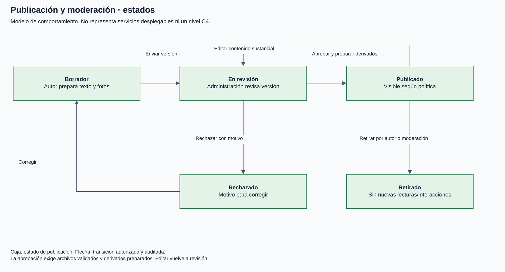
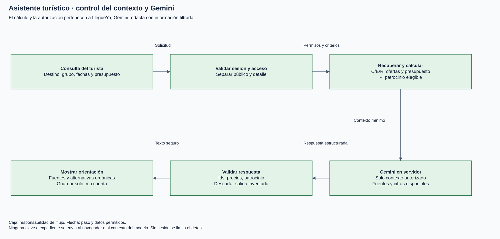
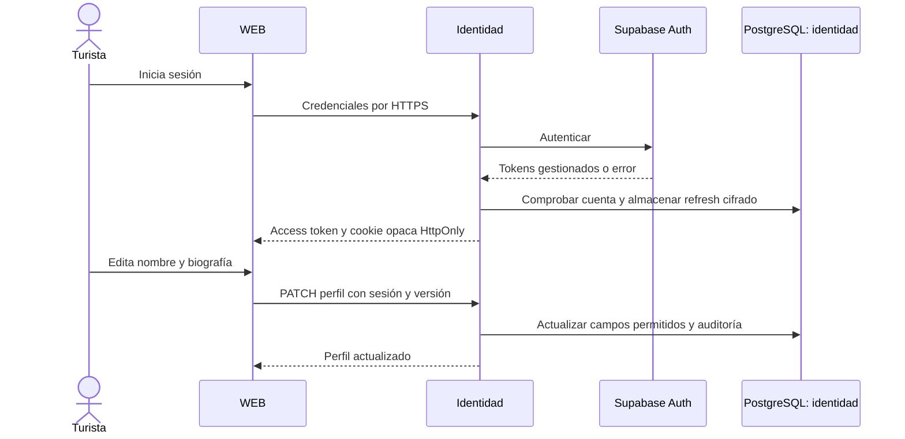
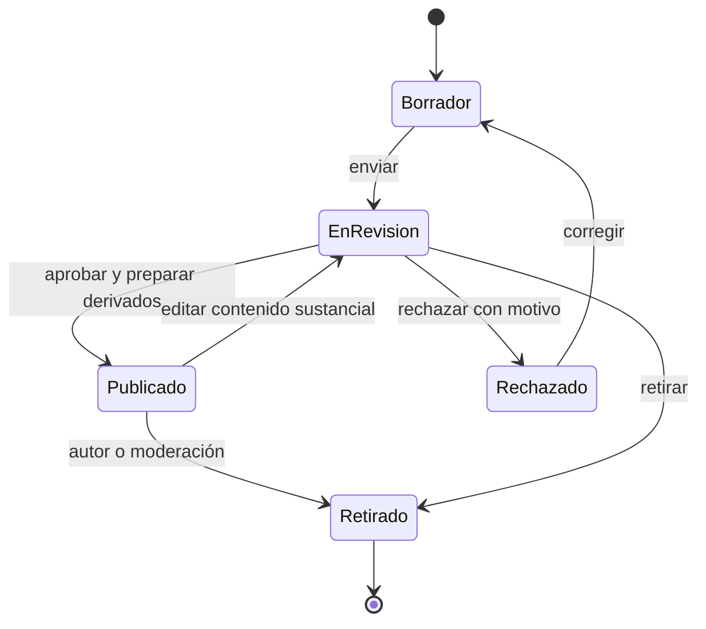
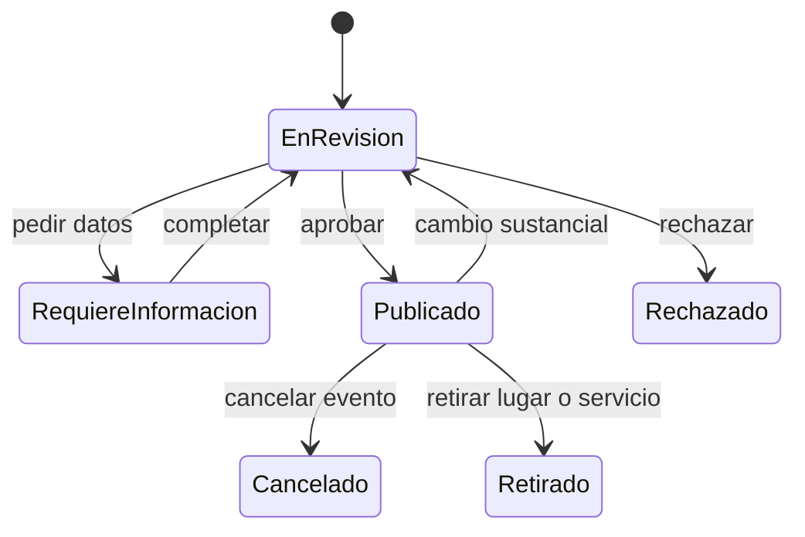
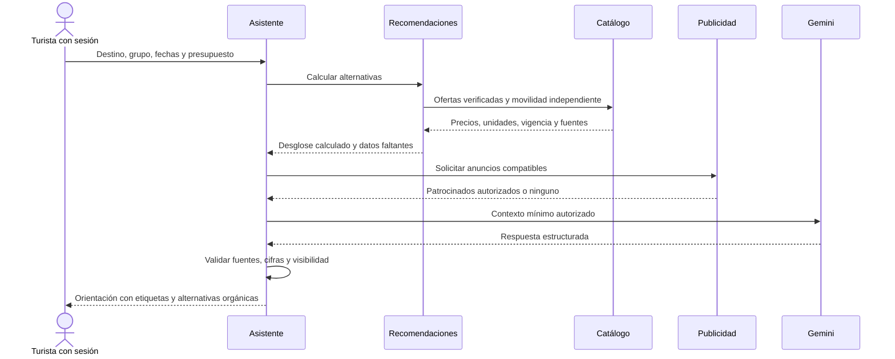

# 06 · Comportamiento, secuencias y estados

[Índice](README.md) · [Anterior](05-contratos-e-integraciones.md) · [Siguiente](07-interfaz-y-experiencia.md)

## 6.1 Registro, sesión y perfil

No se copia contraseña al esquema `identidad`. Un fallo de persistencia al crear perfil se concilia con Auth mediante operación idempotente; una cuenta incompleta no obtiene permisos comerciales. Cambios de correo/contraseña pasan por flujos gestionados con reautenticación; editar perfil no los reemplaza. Roles se modifican en operación administrativa separada.

## 6.2 Publicación y carga de fotos

1. M valida sesión y objetivo visible, registra borrador y autoriza una carga privada limitada.
2. WEB carga el binario al destino autorizado; M confirma formato real, tamaño, propiedad y vínculo. Un archivo no confirmado no forma parte de la publicación.
3. El autor envía a revisión. Administración aprueba/rechaza con motivo y versión. Aprobación confirma metadatos y outbox, y genera derivados aprobados mediante tarea idempotente.
4. El muro solo entrega la versión aprobada. Las galerías completas se sirven por la API dueña con autorización actual. Editar cambia versión y suspende difusión de la versión modificada hasta revisión.
5. Retirar el padre revoca acceso e interacción, oculta descendientes y programa invalidación/borrado de derivados. Cargas huérfanas se limpian por tarea.

Una aprobación no publica un archivo que aún no esté saneado. El proceso conserva un estado técnico de derivados pendientes; la tarjeta se publica al completar los requisitos de su versión. Un reintento no duplica fotos ni eventos.

## 6.3 Like y respuesta concurrentes

La API autentica y valida visibilidad con el dueño del objetivo. PUT de like ejecuta inserción con restricción única; una repetición confirma el mismo estado. DELETE es idempotente. Responder exige padre visible del mismo objetivo, raíz consistente y profundidad admitida; la transacción local impide mover padre/raíz. Las consultas comprueban visibilidad actual, aunque una notificación de retiro se retrase. Un fallo de validación remota rechaza una interacción nueva.

## 6.4 Calendario, movilidad y propuestas

Una propuesta de evento/lugar/punto de movilidad conserva autor, foto, coordenadas, fuente y versión. Administración puede pedir información o aprobar/rechazar. Solo aprobación publica. Para movilidad se separa punto físico de oferta de operador y tramo servido: un terminal no garantiza que un operador esté verificado ni que existan asientos disponibles.

Cancelar evento guarda estado y versión junto a outbox. El ejecutor de E invalida tareas anteriores y comprueba estado/preferencia inmediatamente antes de emitir avisos. P recibe invalidación y revalida E en cada nueva autorización publicitaria. No se promete borrar retrospectivamente contenido que el turista ya vio. El correo opcional no condiciona la bandeja.

## 6.5 Gratuidad, pago y entrega de anuncios

| Entidad | Estados y transiciones válidas |
|---|---|
| Beneficio | Disponible → Activo al aprobar primera activación; Activo → Vencido por reloj; Activo → Suspendido/Revocado por decisión auditada. Una suspensión no extiende fin automáticamente. |
| Pago | Pendiente → Confirmado o Rechazado mediante revisión administrativa. Corrección conserva historial; no sustituye el pago anterior sin rastro. |
| Campaña | Borrador → EnRevision → Activa, o Rechazada; Activa → Suspendida/Vencida/Retirada. Reanudar requiere revalidación y condiciones vigentes. |
| Reserva de cuota | Reservada → ImpresionConfirmada o Expirada/Cancelada. Un clic se vincula a una entrega válida. |

Al activar se valida negocio y objetivo, se asigna beneficio mediante unicidad local o se comprueba contratación/pago y se copian condiciones. Dos solicitudes simultáneas para un negocio no generan dos beneficios. Los meses se calculan en America/Lima y se persiste fin UTC; el 31 se ajusta al último día del mes destino cuando corresponde.

Selección: comprobar compatibilidad y estados actuales, reservar cuota/frecuencia atómicamente, emitir entrega_id, presentar etiqueta de patrocinio y medir impresión solo tras visibilidad. Umbral propuesto: al menos 50 % del aviso visible por 1 segundo. No es una medición implementada ni una garantía comercial. Para usuarios sin cuenta se usa límite por contexto/sesión temporal y métricas estimadas sin fingerprinting; no se anuncia alcance único exacto de personas anónimas.

## 6.6 Planificación independiente y Gemini

El usuario puede pedir solo terminales y traslados sin paquete. Sin sesión, A ofrece orientación general y conserva un destino de retorno interno seguro al solicitar ingreso. Si Gemini inventa una cifra o id, se descarta la salida y se muestra el resultado determinista disponible.

## 6.7 Mapa interactivo

WEB inicializa la región elegida, carga teselas y consulta marcadores para la vista. Arrastrar o hacer zoom actualiza el viewport con espera breve propuesta de 250 ms y cancela resultados antiguos. Seleccionar marcador muestra tarjeta pública; abrir detalle valida sesión. Nunca se invoca geolocalización ni se almacena un recorrido. Las coordenadas se incorporan mediante revisión del catálogo, no por un permiso de GPS del turista.
