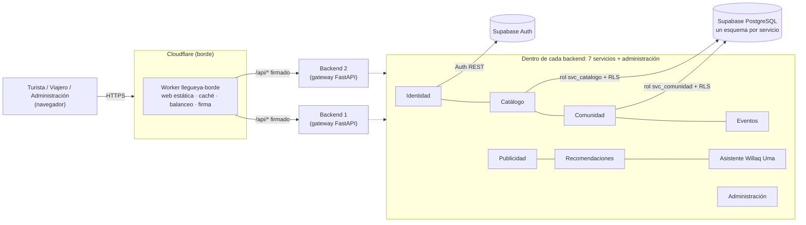
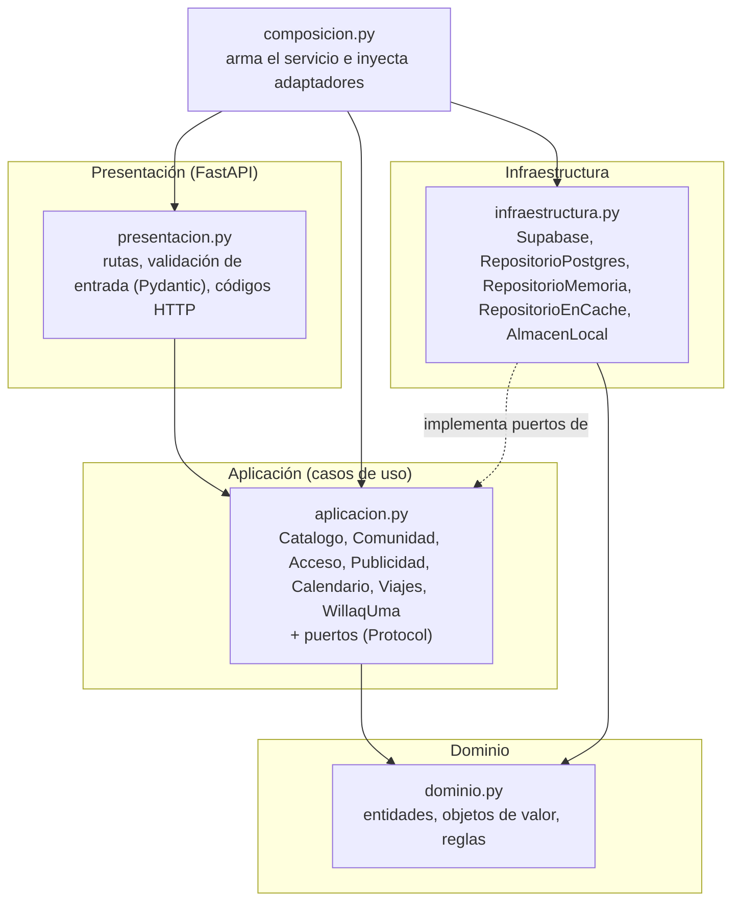
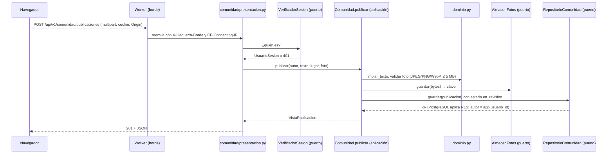

# 1. Estilo y patrón arquitectónico implementados

Este documento muestra **cómo quedó en código** la arquitectura decidida en el Sprint 1: el estilo distribuido orientado a servicios de negocio ([estilo](../02-arquitectura-software/estilo-arquitectonico.md)) y Clean Architecture dentro de cada servicio ([enfoque](../02-arquitectura-software/enfoque-arquitectonico.md)). Cada afirmación apunta a una carpeta, una clase o una prueba que la comprueba.

## 1.1 Estilo: servicios de negocio detrás de una entrada única

| Decisión del Sprint 1 | Cómo está implementada | Dónde verlo |
|---|---|---|
| Siete servicios con límites propios | Un paquete Python por servicio: `services/identidad`, `catalogo`, `comunidad`, `eventos`, `publicidad`, `recomendaciones`, `asistente` | `services/` |
| Despliegue independiente | Cada servicio con base de datos o API propia tiene su `composicion.crear_app()`. La misma imagen Docker arranca uno u otro con `SERVICIO=gateway\|identidad\|catalogo\|comunidad` | `Dockerfile`, `compose.yaml` |
| Entrada API estable | El **gateway** compone los servicios bajo `/api/v1/...` en un solo origen (desarrollo y despliegue pequeño). En `compose.yaml`, nginx enruta por prefijo hacia contenedores separados, con Catálogo en 2 réplicas | `services/gateway/composicion.py`, `infra/nginx/llegueya.conf` |
| Datos propios por servicio | Un esquema PostgreSQL por servicio, un rol `svc_*` por servicio y RLS en todas las tablas. Ningún servicio lee tablas de otro | `supabase/migrations/`, `tests/test_postgres.py` |
| Identidad como dueña de la sesión | Los demás servicios reciben un `VerificadorSesion` (puerto) y nunca leen datos de Identidad: en proceso usan `verificador_local` y separados usan `VerificadorHttp` | `services/compartido/sesion.py` |
| Escalar por demanda | Réplicas detrás del Worker de Cloudflare, con afinidad de sesión y *failover* | `infra/cloudflare/borde/` |
| Fallos parciales acotados | Willaq Uma responde solo con datos locales (no depende de una IA externa). Si un backend cae, el borde lo saca 30 s de la rotación | `services/asistente/`, `tests/jest/unidad/borde.test.mjs` |

Los servicios **no se importan entre sí**: lo verifica `tests/test_arquitectura.py::test_servicios_no_se_importan_entre_si`. La única pieza que conoce a todos es la composición del gateway. Por ejemplo, ahí se entrega a Willaq Uma una función que lee el catálogo, no el repositorio del catálogo.

## 1.2 Patrón: Clean Architecture en cada servicio

**Regla de dependencias:** las flechas de código apuntan hacia el dominio. El dominio no conoce ninguna otra capa. La aplicación define puertos (`typing.Protocol`) y no sabe si detrás hay PostgreSQL, memoria o una API.

| Servicio | Dominio (`dominio.py`) | Puertos (en `aplicacion.py`) | Adaptadores (`infraestructura.py`) |
|---|---|---|---|
| Identidad | `Usuario`, `Credencial`, `AuthError`, reglas de correo, clave y nombre | `ProveedorIdentidad` | `Supabase` (Auth REST con PKCE) |
| Catálogo | `Lugar`, `Foto`, `TIPOS`, `crear_slug`, límites de Ayacucho | `RepositorioLugares`, `RepositorioFavoritos` | `RepositorioPostgres`, `RepositorioMemoria`, `RepositorioEnCache`, `FavoritosPostgres` |
| Comunidad | `Publicacion`, `Comentario`, `Autor`, `Reporte`, reglas de texto y foto | `RepositorioComunidad`, `AlmacenFotos` | `RepositorioPostgres`, `RepositorioMemoria`, `AlmacenLocal` |
| Eventos | `Evento` | `RepositorioEventos` | `RepositorioMemoria` |
| Publicidad | `Plan`, `Solicitud`, `RUBROS`, `REQUISITOS`, reglas de precio y ubicación | `RepositorioPublicidad` | `RepositorioMemoria` |
| Recomendaciones | `Viaje`, `PlanInvalido` | `RepositorioViajes` | `RepositorioMemoria` |
| Asistente | `Respuesta`, `Experiencia`, vocabulario (`TEMAS`, `GUSTOS`), `normalizar` | Funciones de lectura que entrega la composición (catálogo, calendario, comunidad) | — (usa los puertos de los otros servicios) |

La regla no solo está escrita: `tests/test_arquitectura.py` la revisa en cada ejecución del CI.

| Prueba | Qué impide |
|---|---|
| `test_dominio_y_aplicacion_no_dependen_de_tecnologia` | Que `dominio.py` o `aplicacion.py` importen FastAPI, Pydantic, psycopg, httpx o uvicorn |
| `test_dominio_no_importa_otras_capas` | Que el dominio dependa de cualquier otra capa o servicio |
| `test_aplicacion_no_conoce_infraestructura_ni_presentacion` | Que un caso de uso instancie un adaptador concreto |
| `test_servicios_no_se_importan_entre_si` | Que un servicio use el código interno de otro |
| `test_cada_servicio_tiene_dominio_aplicacion_y_presentacion` | Que un servicio mezcle sus capas en un solo archivo |

## 1.3 Un caso de uso de punta a punta

Publicar una experiencia con foto (RF06, RF09):

Cambiar PostgreSQL por memoria, o el disco local por R2, solo toca `composicion.py` e `infraestructura.py`. Las mismas pruebas de aplicación pasan con ambos adaptadores (`tests/test_plataforma.py` en memoria y `tests/test_postgres.py` en PostgreSQL real).

## 1.4 Frontend y borde

- **Web** (`apps/web`): módulos ES sin compilación, separados como capas finas. `api.js` es el único que habla con la API, `estado.js` guarda la sesión, `util.js` reúne las reglas puras probadas con Jest, `vistas/` pinta cada pantalla y `componentes.js` contiene las piezas reutilizables.
- **Borde** (`infra/cloudflare/borde`): `logica.js` contiene las reglas (qué se cachea, a qué backend ir y cuándo darlo por caído) y `borde.js` solo es el punto de entrada del Worker.
