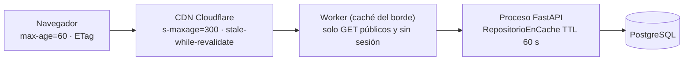

# 4. Comportamiento de la base de datos y estrategia de caché

## 4.1 Modelo de datos y aislamiento

- **Un esquema por servicio** en Supabase PostgreSQL (`identidad`, `catalogo`, `comunidad`, `eventos`, `publicidad`, `recomendaciones`, `asistente`): 67 tablas, **todas con RLS activado**, y 33 políticas de acceso.
- **Un rol por servicio** (`svc_catalogo`, `svc_comunidad`…) sin permiso de login. El backend se conecta con un login propio (`llegueya_catalogo`…) y hace `set local role svc_*` en cada transacción. El login solo no puede leer tablas.
- **Contexto por transacción:** cada consulta fija `app.usuario_id` y, si la sesión es de administración, `app.es_admin`. Las políticas RLS deciden con esos dos valores. Se usa `set_config(..., true)`, así que se borran al terminar la transacción y no se filtran a la siguiente conexión del *pool*.
- **El backend nunca usa** `postgres` ni la clave `service_role`.

## 4.2 Mediciones con volumen

`scripts/analizar-bd-y-cache.py` crea una base desechable con **las mismas migraciones** que Supabase, carga 20 000 publicaciones, 60 000 me gusta, 10 000 comentarios y 500 autores, y mide con **los repositorios reales del backend**. Resultado completo: [`evidencias/bd-y-cache.json`](evidencias/bd-y-cache.json).

### RLS en acción (20 000 publicaciones: 17 600 publicadas, 2 000 en revisión y 400 retiradas)

| Quién consulta (rol `svc_comunidad`) | Filas que ve | Regla |
|---|---|---|
| Visitante anónimo | 17 600 | Solo `publicado` |
| Autor con 3 publicaciones en revisión | 17 603 | Lo publicado más lo suyo |
| Administración (`app.es_admin = true`) | 20 000 | Todo, para moderar |

La base de datos aplica los permisos aunque el código tuviera un error. Esa es la segunda línea de defensa que pide EQ-04.

### Índices: planes de ejecución reales (`EXPLAIN ANALYZE`)

| Consulta | Con índice | Sin índice | Diferencia |
|---|---|---|---|
| Página del muro (10 últimas publicadas) | **0.039 ms** · `Index Scan using publicacion_muro`, 3 bloques leídos | 4.78 ms · `Seq Scan` de 20 000 filas + `Sort` | **≈ 120 veces más rápido**, y la diferencia crece con el volumen |
| Me gusta de las 10 publicaciones visibles | **6.3 ms** · usa `like_objetivo` | 11.4 ms · `Seq Scan` de 60 000 filas | ≈ 1.8 veces |

El índice `publicacion_muro (estado, creado_en desc)` coincide exactamente con el filtro y el orden del muro. Por eso PostgreSQL lee solo las 10 filas que necesita, sin ordenar toda la tabla. Fragmento del plan:

```text
Limit  (actual time=0.017..0.022 rows=10)
  ->  Index Scan using publicacion_muro on publicacion
        Index Cond: (estado = 'publicado'::text)
        Buffers: shared hit=3
Execution Time: 0.039 ms
```

### Latencia del caso de uso completo

| Operación (con RLS, a través de `Comunidad.muro`) | p50 | p95 |
|---|---|---|
| Primera página del muro (publicaciones + me gusta + comentarios) | 26.9 ms | 30.5 ms |
| Página profunda (desde la publicación 5 000) | 30.6 ms | 39.9 ms |
| Catálogo completo directo de PostgreSQL | 5.3 ms | 6.7 ms |

La paginación profunda casi no cuesta más gracias al índice. La mayor parte de los ~27 ms del muro se va en abrir conexiones (≈ 2.6 ms cada una en local). En producción las reutiliza el *pooler* de Supabase (Supavisor), y si la carga crece el siguiente paso es un *pool* en proceso (`psycopg_pool`).

## 4.3 Estrategia de caché: cuatro niveles



| Nivel | Qué guarda | Duración | Invalidación | Dónde |
|---|---|---|---|---|
| 1. Navegador | Respuestas públicas del catálogo; estáticos (`/vendor`, `/fuentes` 30 días) | `max-age=60` | ETag → **304 Not Modified** sin volver a enviar el cuerpo | `catalogo/presentacion.py`, `apps/web/_headers` |
| 2. CDN Cloudflare | Las mismas respuestas públicas, compartidas entre todos los turistas | `s-maxage=300` + `stale-while-revalidate=60` | Por tiempo; al ser contenido curado, 5 min es aceptable | Cabeceras `Cache-Control` |
| 3. Worker (borde) | `GET /api/v1/catalogo/lugares`, `/mapa`, `/destinos` **sin cookie de sesión** | Lo que diga el backend | No guarda nada `private`, `no-store` ni con `Set-Cookie` | `infra/cloudflare/borde/src/logica.js` |
| 4. Proceso | Lista de lugares en memoria (patrón Proxy) | TTL 60 s (`CATALOGO_CACHE_TTL`) | Por TTL **y de inmediato** cuando administración crea, edita o retira un lugar | `catalogo/infraestructura.py::RepositorioEnCache` |

**Qué no se cachea nunca:** fichas vistas con sesión, muro personalizado, sesión, panel de administración y Willaq Uma. Responden `Cache-Control: private, no-store`, así ningún intermediario mezcla datos de dos personas (EQ-04).

### Efecto medido

| Medición | Resultado |
|---|---|
| Catálogo desde PostgreSQL vs desde la caché en proceso | 5.3 ms → **0.0002 ms** (p50); 1 000 lecturas: 1 000 aciertos tras la primera carga |
| Petición repetida con `If-None-Match` | **304** sin cuerpo (`tests/jest/api/catalogo.test.mjs`) |
| Caché del borde con `wrangler dev` | Primera lectura `X-Cache-Borde: MISS`, siguientes `HIT` sin llamar al backend |
| Carga de 2 000 usuarios ([doc. 7](07-validacion-atributos-calidad.md)) | El límite fue la CPU del proceso Python (≈ 750 peticiones/s por réplica), no el acceso a datos |

## 4.4 Conclusiones

1. Con los índices y RLS actuales, las consultas de lectura cuestan menos de 1 ms en la base, incluso con 20 000 publicaciones. Bajo carga, la base no es el cuello de botella.
2. La caché en cuatro niveles hace que la mayoría de las lecturas públicas (catálogo, mapa, destinos) no lleguen a PostgreSQL. En producción, la CDN y el borde además las sirven sin llegar al backend.
3. La seguridad de los datos no depende de la caché: lo privado nunca se guarda en cachés compartidas y RLS filtra en la base.
