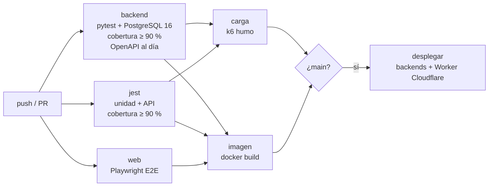

# 6. Pruebas automatizadas, cobertura y CI/CD

## 6.1 Qué se prueba y con qué herramienta

| Nivel | Herramienta | Qué valida | Archivos |
|---|---|---|---|
| Unidad (JavaScript) | **Jest** | Reglas puras de la web (rutas, claves, saludos de Willaq Uma, ofertas, «cómo llegar», calendario) y del borde Cloudflare (caché, afinidad, *failover*) | `tests/jest/unidad/` |
| Reglas de negocio de la API | **Jest** + servidor real | Cada criterio de aceptación del [SDD](02-especificaciones-sdd.md) contra FastAPI en ejecución: permisos, moderación, reportes, verificación de negocios, Willaq Uma sin inventar, contrato OpenAPI | `tests/jest/api/` |
| Unidad e integración (Python) | pytest | Dominio, casos de uso y rutas HTTP de cada servicio | `tests/test_*.py` |
| Base de datos | pytest + PostgreSQL 16 | Migraciones reales, RLS por rol, repositorios Postgres | `tests/test_postgres.py` |
| Arquitectura | pytest | Regla de dependencias de Clean Architecture y separación entre servicios | `tests/test_arquitectura.py` |
| Extremo a extremo | Playwright | 23 recorridos reales en Chromium: registro, recuperación de clave, publicar, reportar, administración, mapa y móvil | `tests/web-navegador.mjs` |
| Carga | k6 | Rendimiento y escalabilidad hasta 2 000 usuarios concurrentes | `tests/carga/k6-plataforma.js` |

Las pruebas de API con Jest levantan solas el backend (`tests/jest/api/servidor.mjs`) con un doble de Supabase Auth. No necesitan internet ni crean cuentas reales. Cada cliente de prueba entra como si viniera del Worker de Cloudflare, con su propia IP, así que también se ejercita el candado de origen.

## 6.2 Cómo ejecutarlas

```bash
npm install                                  # Jest (una vez)
npm test                                     # Jest: unidad + API
npm run test:cobertura                       # Jest con cobertura → reports/jest-coverage/index.html
python -m pytest tests -q                    # pytest (las de PostgreSQL necesitan TEST_DATABASE_URL)
python -m coverage run -m pytest tests -q && python -m coverage json && python scripts/comprobar-cobertura.py
```

## 6.3 Resultados y cobertura

| Suite | Pruebas | Resultado | Cobertura |
|---|---|---|---|
| Jest · unidad | 26 | Todas pasan | `util.js` 100 % líneas · 99 % ramas; `logica.js` (borde) 100 % líneas · 93 % ramas |
| Jest · API | 58 | Todas pasan | Ejercita 51 de las 60 operaciones documentadas en OpenAPI; las 9 restantes (Google, recuperar clave, fotos, pago manual…) las cubren pytest y E2E |
| pytest (incluye PostgreSQL y arquitectura) | 161 | Todas pasan | ≥ 90 % de líneas y ramas en **cada** servicio (tabla abajo) |
| Playwright E2E | 23 pasos | Todos pasan | — |

Umbral obligatorio: **90 % de líneas y ramas**. Jest lo exige en `jest.config.mjs` (`coverageThreshold`) y Python en `scripts/comprobar-cobertura.py`. Si alguno baja, el CI falla.

| Servicio (pytest) | Líneas | Ramas |
|---|---|---|
| asistente | 97.9 % | 90.7 % |
| catalogo | 99.8 % | 96.7 % |
| compartido | 100 % | 100 % |
| comunidad | 94.7 % | 92.5 % |
| eventos | 100 % | 100 % |
| gateway | 98.5 % | 93.8 % |
| identidad | 99.2 % | 91.3 % |
| publicidad | 99.4 % | 97.4 % |
| recomendaciones | 100 % | 100 % |

El reporte HTML de Jest queda en `reports/jest-coverage/index.html`, y su resumen en [`evidencias/jest-cobertura.json`](evidencias/jest-cobertura.json).

## 6.4 Flujo CI/CD en GitHub Actions

`.github/workflows/ci.yml` corre en cada *push* y *pull request*:



| Job | Falla si… |
|---|---|
| `backend` | Una prueba Python falla, la cobertura de un servicio baja de 90 %, o `docs/07-sprint2/api/openapi.json` no coincide con el código |
| `jest` | Una prueba Jest falla o la cobertura baja del umbral. Publica el reporte como artefacto `cobertura-jest` |
| `web` | Un recorrido E2E falla. Publica capturas |
| `carga` | La prueba de humo de k6 supera 1 % de errores o el p95 de las metas |
| `imagen` | La imagen Docker no construye |
| `desplegar` | Solo en `main` y si todo lo anterior pasó: dispara el despliegue de los backends y publica el Worker con `wrangler` |
