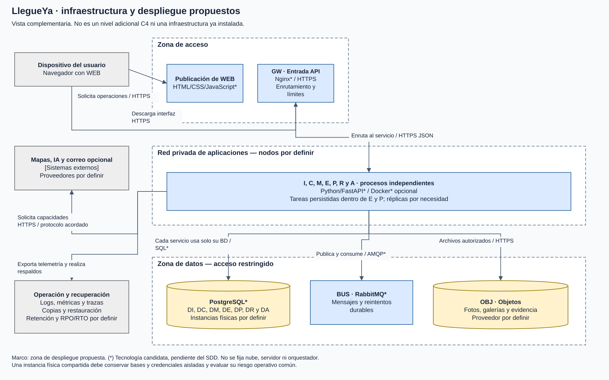
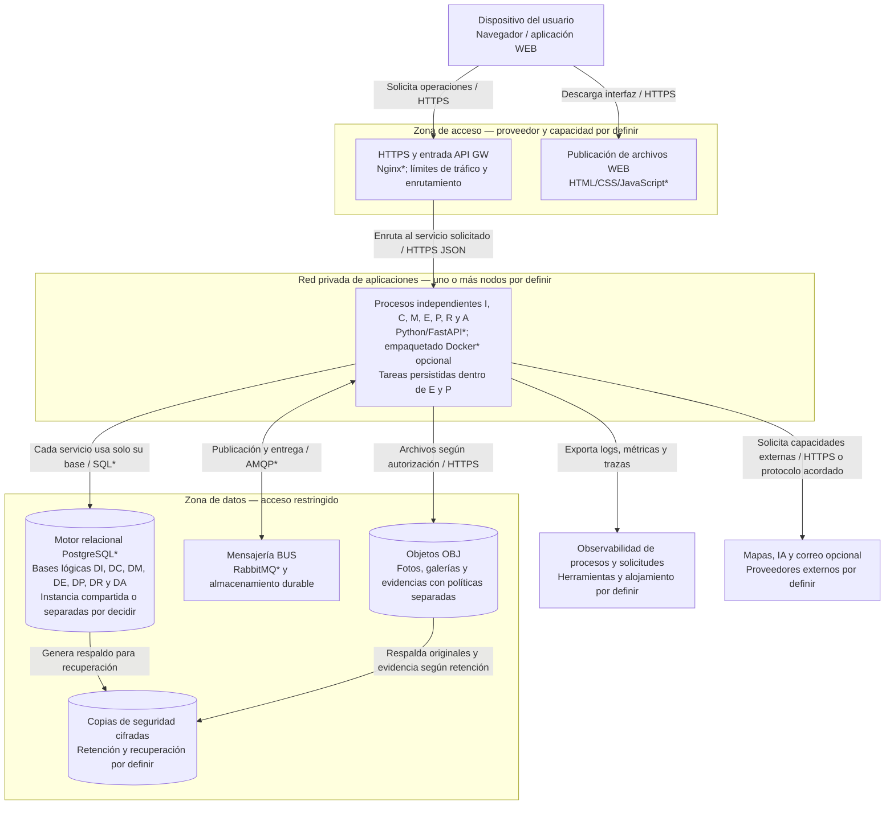

# Despliegue e infraestructura de LlegueYa

[Diagramas ampliables en navegador](diagramas/index.html) · [Archivo editable Draw.io](diagramas/LlegueYa-C4.drawio)

Vista complementaria a C4. **Estado:** propuesta de diseño pendiente del SDD, sin servidores contratados ni mediciones. La ubicación física no cambia las responsabilidades de C2. Clean Architecture se mantiene dentro de cada servicio.

**Leyenda:** marco = zona de despliegue propuesta, no contenedor C4; caja = proceso o recurso operativo; cilindro = almacenamiento. (*) indica candidato. No representa un clúster ya implementado. Una instancia física inicial compartida implica un fallo común y no sustituye aislamiento de permisos. La alta disponibilidad requiere concretar réplicas, recuperación y presupuesto.

La CDN contratada distribuye únicamente derivados públicos de OBJ; galerías completas y evidencia privada requieren autorización. Las credenciales y claves se gestionan fuera de repositorios y del navegador. El equipo deberá definir ubicación, topología, cifrado, rotación de secretos, métricas, RPO/RTO y pruebas de restauración en el SDD.

## Razones de la propuesta

La carga de lectura, fotos y conversación es distinta: la separación permite replicar Comunidad o Asistente según demanda. El almacenamiento de objetos evita guardar binarios voluminosos en tablas transaccionales. El transporte durable desacopla cambios y recordatorios. Las bases propias evitan que una función modifique tablas de otra. Esta elección exige más operación, contratos y manejo de fallos parciales; no implica adoptar la infraestructura de Facebook o Instagram.
