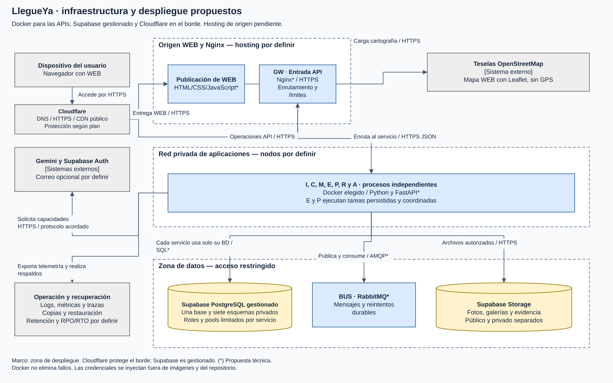
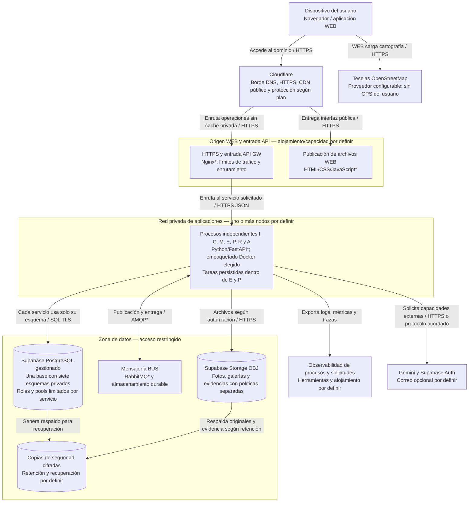

# Despliegue e infraestructura de LlegueYa

[Diagramas ampliables en navegador](diagramas/index.html) · [Archivo editable Draw.io](diagramas/LlegueYa-C4.drawio)

Vista complementaria a C4. Las mediciones de la primera versión (réplicas, caída de un backend y carga) están en [Sprint 2](../docs/07-sprint2/07-validacion-atributos-calidad.md). La ubicación física no cambia las responsabilidades de C2. Clean Architecture se mantiene dentro de cada servicio.

**Leyenda:** marco = zona de despliegue propuesta, no contenedor C4; caja = proceso o recurso operativo; cilindro = almacenamiento. (*) indica candidato. No representa un clúster ya implementado. Una instancia física inicial compartida implica un fallo común y no sustituye aislamiento de permisos. La alta disponibilidad requiere concretar réplicas, recuperación y presupuesto.

Cloudflare CDN distribuye únicamente derivados públicos de OBJ; galerías completas y evidencia privada se sirven mediante la API dueña con autorización actual. Las credenciales y claves se gestionan fuera de repositorios y del navegador. El SDD precisa topología y controles, con RPO/RTO propuestos y pendientes externos en sus capítulos 09–10.

## Razones de la propuesta

La carga de lectura, fotos y conversación es distinta: la separación permite replicar Comunidad o Asistente según demanda. El almacenamiento de objetos evita guardar binarios voluminosos en tablas transaccionales. El transporte durable desacopla cambios y recordatorios. Los esquemas y permisos propios evitan que una función modifique tablas de otra; la instancia gestionada conserva un riesgo común de disponibilidad. Esta elección exige más operación, contratos y manejo de fallos parciales; no implica adoptar la infraestructura de Facebook o Instagram.

[Diseño operativo y límites de caché](../docs/05-sdd/09-despliegue-y-operacion.md).
