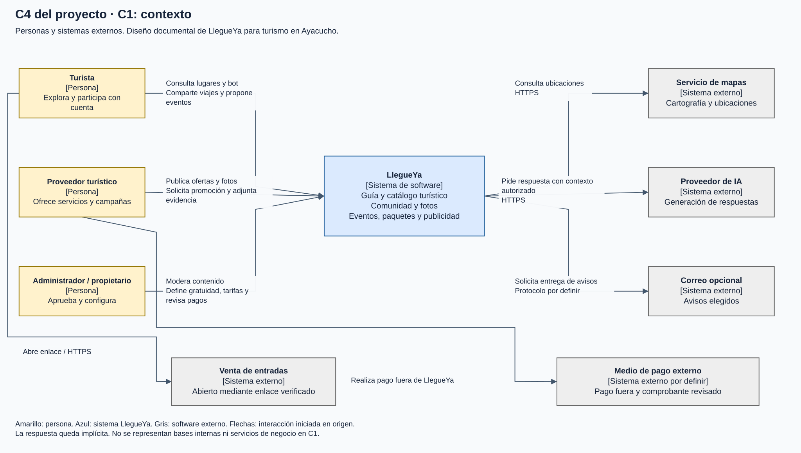
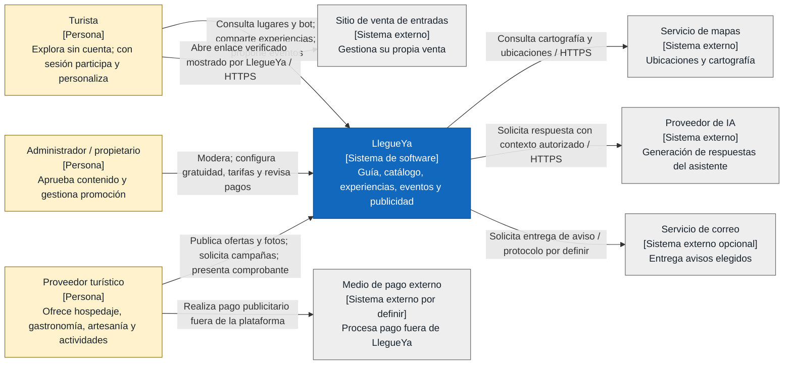

# C4 del proyecto: C1, contexto de LlegueYa

[Diagramas ampliables en navegador](diagramas/index.html) · [Archivo editable Draw.io](diagramas/LlegueYa-C4.drawio)

**Alcance:** un sistema de software para turismo, comunidad y publicidad en Ayacucho. **Público:** negocio y equipo técnico. **Estado:** diseño propuesto, sin implementación. C1 presenta personas y software externo, sin mostrar servicios internos ni bases de datos.

**Leyenda:** amarillo = persona; azul = sistema de interés; gris = sistema externo. La flecha nombra la interacción iniciada por el origen. Las respuestas quedan implícitas. Un único sistema en C1 no implica un monolito.

Turista y visitante son el mismo actor en distintos estados de autenticación. Sin sesión accede a vistas previas; el detalle, galerías completas, planificación personal, publicaciones, likes en fotos/comentarios y respuestas requieren sesión. Las propuestas de lugares, camping y eventos necesitan revisión administrativa antes de formar parte del catálogo o calendario.

LlegueYa no se integra automáticamente con el medio de pago ni vende entradas. El proveedor paga fuera y presenta evidencia privada; el administrador la revisa. La publicidad requiere elegibilidad y moderación, además de beneficio gratuito vigente o pago confirmado. Por defecto, el beneficio inicial dura un mes calendario, configurable por administración. El bot identifica el patrocinio y respeta destino, fechas, grupo y presupuesto.

No se dibuja una API de pago o venta inexistente. [C2](Nivel2-DiagramadeContenedores.md) muestra qué contenedores realizan las integraciones de mapas, IA y correo. Trazabilidad: RF01-RF59, ADR-001 a ADR-022 y [alcance](../docs/04-especificacion-funcional/01-analisis-y-alcance.md).
