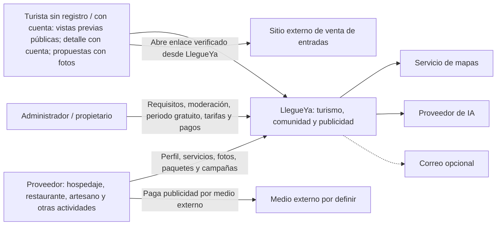

# Nivel 1 - Diagrama de contexto del sistema

LlegueYa es una plataforma de guía turística, comunidad y publicidad de negocios de Ayacucho. Un solo sistema en el contexto no implica un solo despliegue: internamente usa servicios independientes. Diseño documental, sin implementación.

El proveedor presenta evidencia del pago y el administrador la revisa en LlegueYa; no existe integración automática con el medio externo. La publicidad se habilita por beneficio gratuito vigente o pago confirmado, además de requisitos y moderación. El administrador configura un mes gratis inicial por defecto y planes de mayor alcance.

La mayor exposición del bot se identifica como patrocinada y respeta destino, fechas, grupo y presupuesto. Incluye experiencias de viajeros, likes en fotos/comentarios, respuestas en hilos y notificaciones elegidas; participar requiere registro e inicio de sesión. Turistas y proveedores pueden proponer eventos; los turistas proponen lugares y actividades de camping para aprobación administrativa. Fuera de alcance: venta de entradas, reservas, QR, aforo y chatbot en WhatsApp/Telegram.

Trazabilidad: RF01-RF59 y ADR-001 a ADR-022; [reglas comerciales](../docs/04-especificacion-funcional/03-publicidad-y-periodo-gratuito.md).