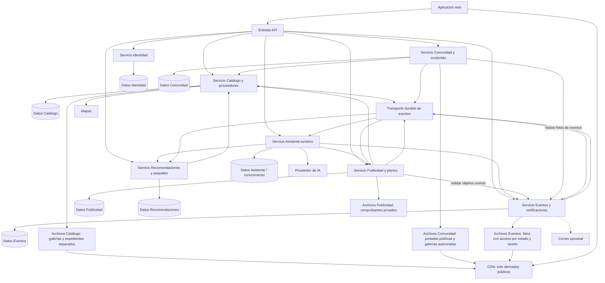

# Nivel 2 - Diagrama de contenedores

Arquitectura distribuida orientada a servicios de negocio. Cada servicio tiene despliegue, almacenamiento y credenciales propios; puede compartir servidor físico de datos sin compartir tablas ni transacciones. La entrada API enruta; cada servicio ejecuta su lógica y valida permisos.

Eventos y Publicidad incluyen ejecutores programados de tareas persistidas, con coordinación entre réplicas. Consultas inmediatas usan REST; cambios usan eventos con outbox, idempotencia y versiones. CDN sirve portadas públicas y derivados con autorización cuando pertenecen al detalle; nunca publica expedientes ni comprobantes. La API separa vista previa y ficha autenticada; el bot usa la misma política. La redirección de entradas se hace desde el navegador.

No se seleccionan tecnologías, nube ni orquestador. Esta distribución implica operación, seguridad y fallos de red por servicio. [Detalle de contratos y consistencia](../docs/04-especificacion-funcional/02-arquitectura-y-diseno.md).