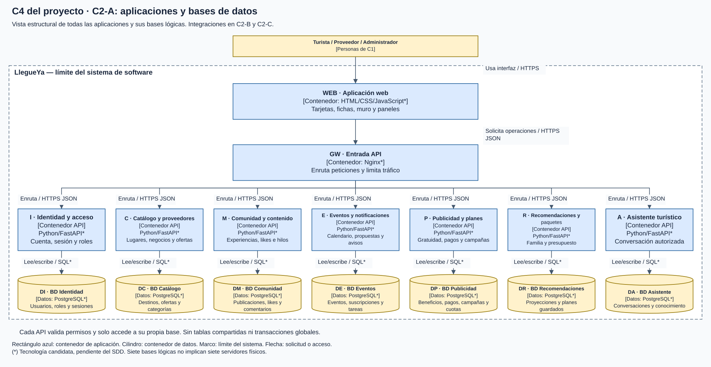
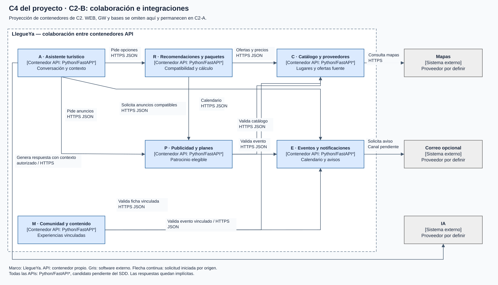
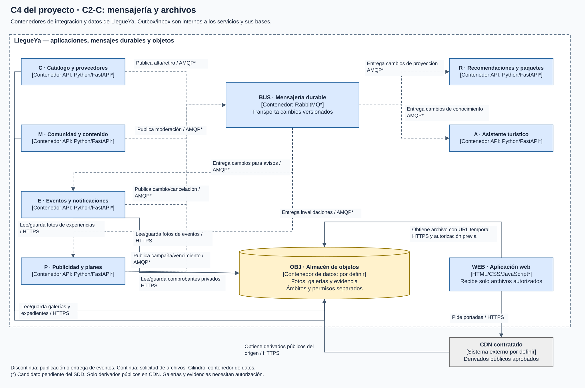
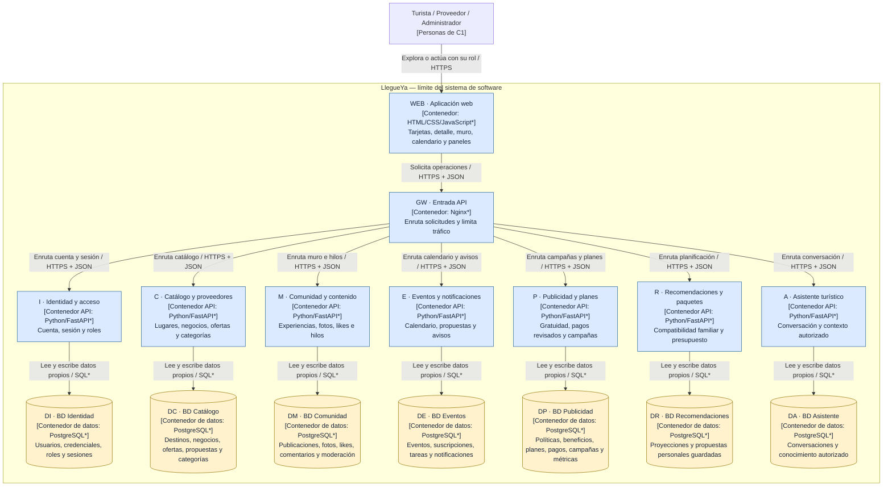
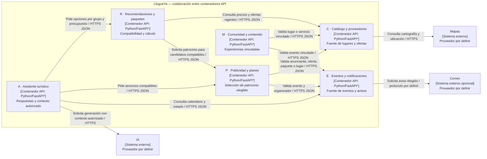
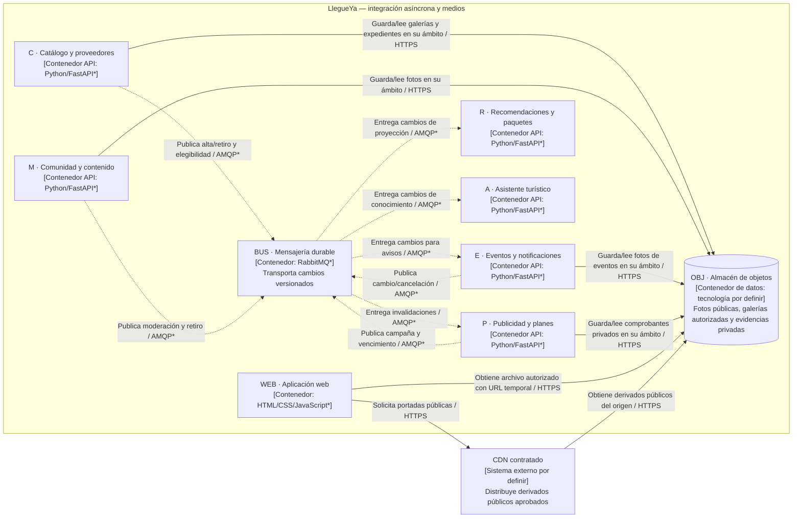

# C4 del proyecto: C2, contenedores de LlegueYa

[Diagramas ampliables en navegador](diagramas/index.html) · [Archivo editable Draw.io](diagramas/LlegueYa-C4.drawio)

**Alcance:** aplicaciones y almacenes dentro de LlegueYa y sus integraciones. **Público:** arquitectura y desarrollo. **Estado:** diseño sin implementación. El estilo es distribuido orientado a servicios de negocio; Clean Architecture se aplica dentro de cada API de negocio. C2 no mezcla componentes internos ni servidores físicos.

El asterisco (*) señala tecnologías candidatas pendientes del SDD. No fija una elección. Un contenedor C4 es una unidad de aplicación o un almacén de datos; Docker es una opción de despliegue distinta.

## C2-A: aplicaciones y propiedad de bases de datos

Vista estructural completa de las aplicaciones y sus siete bases lógicas. Las colaboraciones, mensajería y archivos se detallan en C2-B y C2-C.

**Leyenda C2-A:** rectángulos azules = contenedores de aplicación; cilindros amarillos = contenedores de datos; marco = límite de LlegueYa; flecha continua = solicitud o acceso iniciado por el origen. Todos los servicios validan sesión, rol y propiedad. La entrada API no sustituye esa autorización.

### Inventario de almacenamiento

| ID | Dueño exclusivo | Información y restricciones |
|---|---|---|
| DI | Identidad y acceso | Credenciales protegidas, usuarios, roles y sesiones. Ningún otro servicio lee sus tablas. |
| DC | Catálogo y proveedores | Fichas, ofertas/paquetes comerciales, categorías acreditadas, favoritos y referencias a documentos privados. |
| DM | Comunidad y contenido | Publicaciones, metadatos de fotos, comentarios con padre/raíz, likes únicos y decisiones de moderación. |
| DE | Eventos y notificaciones | Propuestas, eventos/versiones, suscripciones, bandeja, recordatorios persistidos y entregas. |
| DP | Publicidad y planes | Política versionada, beneficio único por negocio, condiciones de contratación, pagos, campañas y cuotas. |
| DR | Recomendaciones y paquetes | Proyecciones de consulta y planes personales. No reemplaza el catálogo fuente. |
| DA | Asistente turístico | Conversaciones y conocimiento/indexación propios. No almacena una copia indiscriminada de expedientes. |
| BUS | Infraestructura de mensajería | Mensajes durables y reintentos. No sustituye bases ni autoriza campañas. |
| OBJ | Almacenamiento de objetos | Binarios de fotos, galerías y evidencias con ámbitos de acceso separados. Las bases guardan metadatos y referencias. |

DI-DA representan **siete bases lógicas propuestas**, no siete servidores obligatorios. El SDD decidirá si comparten una instancia física de PostgreSQL o usan instancias separadas. Se mantienen credenciales y permisos exclusivos, transacciones locales y ausencia de joins, claves foráneas o acceso directo entre bases. Compartir una instancia exige evaluar el riesgo operativo común. No existe una base principal compartida por todos los servicios.

## C2-B: colaboración síncrona e integraciones

Proyección de C2. Se omiten WEB, GW y las bases, visibles en C2-A; no se agregan componentes internos.

**Leyenda C2-B:** marco = sistema LlegueYa; rectángulo marcado API = contenedor propio; rectángulo marcado sistema externo = dependencia fuera del sistema; flecha continua = llamada iniciada por el origen. La respuesta queda implícita. Identidad emite la información de autenticación y cada API la valida según el contrato de sesión/token que definirá el SDD. No se presupone una llamada a Identidad en cada operación.

El navegador abre enlaces externos de entradas. El pago publicitario ocurre fuera y se revisa manualmente: no hay una llamada API desde LlegueYa al medio de pago. Esas relaciones humanas permanecen en C1.

## C2-C: eventos durables y archivos

Vista complementaria de los mismos contenedores. BUS y OBJ están bajo responsabilidad operativa de LlegueYa, aunque el SDD puede contratar servicios administrados.

**Leyenda C2-C:** flechas discontinuas = publicación o entrega de mensajes, dirección productor-broker-consumidor; continuas = operación de archivos; cilindro = almacén. La entrega del broker presupone suscripción del consumidor. Los componentes de outbox/inbox pertenecen al interior de sus servicios y a sus bases locales, no son contenedores separados en esta vista.

La CDN es infraestructura de entrega y no una capacidad de negocio independiente en C1. Solo sirve derivados públicos aprobados. Una galería restringida necesita sesión y autorización mediante el servicio dueño antes de emitir URL temporal. Expedientes y comprobantes se entregan únicamente con autorización por rol/propiedad. El frontend no recibe credenciales del almacén.

Eventos y Publicidad incluyen tareas programadas persistidas y coordinación entre réplicas; no se presume un nuevo microservicio para cada tarea. Outbox transaccional, inbox, versiones e idempotencia toleran duplicados y desorden. Las consultas usan límites de tiempo. Si Publicidad no confirma elegibilidad actual, omite el anuncio.

El detalle de contratos y escenarios está en [arquitectura y diseño](../docs/04-especificacion-funcional/02-arquitectura-y-diseno.md). La distribución física pertenece a [despliegue e infraestructura](Despliegue-e-infraestructura.md). Referencias metodológicas: Mezzalira, pp. 8-11, 14-15 y 24-32; Diagramas C4, pp. 4-13.
