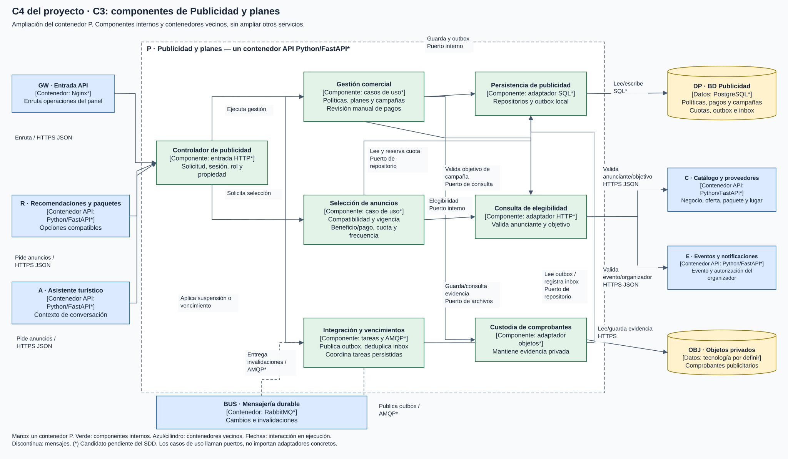
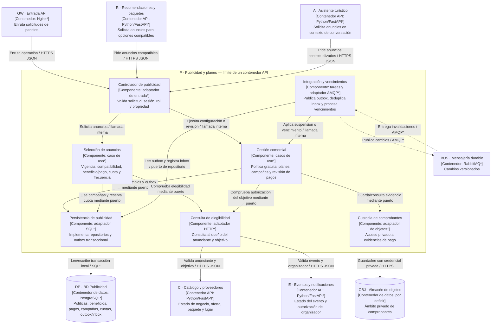

# C4 del proyecto: C3, componentes de Publicidad y planes

[Diagramas ampliables en navegador](diagramas/index.html) · [Archivo editable Draw.io](diagramas/LlegueYa-C4.drawio)

**Alcance:** solo el contenedor P de C2. **Público:** desarrollo. **Estado:** componentes conceptuales, no código. Tecnología candidata: Python/FastAPI*. La base DP, BUS, OBJ y las otras APIs son contenedores externos a P, aunque pertenezcan a LlegueYa.

**Leyenda:** dentro del marco = componentes lógicos de un solo proceso/servicio P, no nuevos despliegues; fuera = contenedores vecinos; cilindros = datos; flecha continua = interacción de ejecución; discontinua = mensajes. (*) describe una propuesta pendiente del SDD. R y A son dos consumidores distintos del mismo contrato.

## Relación con Clean Architecture

El gráfico C3 muestra **colaboración en ejecución**. Los casos de uso definen los puertos que necesitan; los adaptadores concretos implementan esos contratos. Una flecha de llamada hacia un adaptador no significa que Aplicación importe su clase concreta. La composición de dependencias ocurre en la infraestructura de arranque.

| Capa | Contenido en P | Dependencia de código |
|---|---|---|
| Presentación | Controlador API. | Depende de casos de uso e interfaces de entrada. |
| Aplicación | Gestión comercial, Selección de anuncios y puertos de repositorios, elegibilidad y archivos. | Depende de Dominio y sus propios contratos. |
| Dominio | Campaña, BeneficioInicial, Contratación, Plan y reglas de vigencia/elegibilidad. | Sin imports de HTTP, SQL, broker o framework. |
| Infraestructura | Persistencia, consulta HTTP, archivos, mensajería y ejecutores. | Implementa puertos interiores y usa tecnologías externas. |

El dominio no es un componente intermediario por el que pasan todas las llamadas a base de datos. Los componentes de aplicación colaboran con entidades y reglas del dominio. [C4](Nivel4-DiagramadeCodigo.md) amplía el componente Selección de anuncios y muestra las dependencias de código.

El beneficio inicial se asigna una sola vez por negocio, un mes calendario por defecto, con política y fechas copiadas. Los planes pagados necesitan confirmación administrativa. Toda entrega exige anunciante autorizado y objetivo aprobado/vigente; cuota y frecuencia se reservan atómicamente en DP. La cancelación del objetivo impide nuevas autorizaciones y dispara invalidaciones. El pago o una categoría acreditada no sustituyen aprobación ni compatibilidad.

Trazabilidad: RF30-RF33, RF36-RF45, RF54-RF55; ADR-013, ADR-016 a ADR-020. Los demás servicios conservan su estructura de componentes en la [vista general](../docs/02-arquitectura-software/componentes-arquitectonicos.md).
