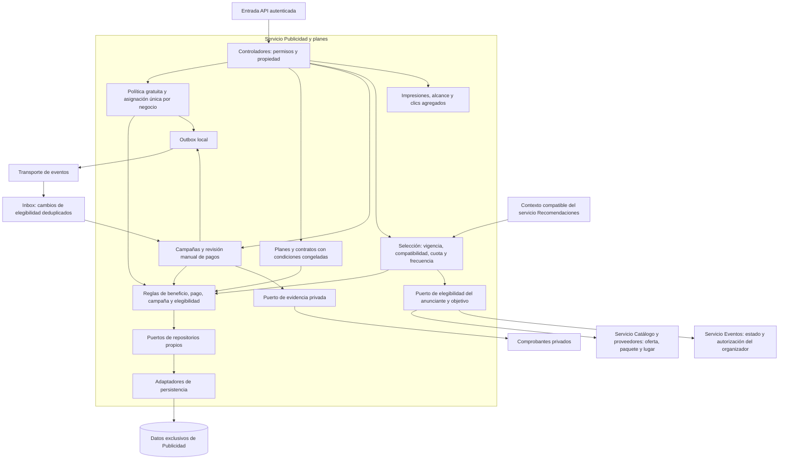

# Nivel 3 - Diagrama de componentes

Se detalla el contenedor **Servicio de Publicidad y planes**, dentro de la arquitectura distribuida. Los demás servicios son dependencias externas a este contenedor. Cada uno aplica su propia Clean Architecture.

Controladores conocen casos de uso; aplicación conoce dominio y puertos; adaptadores implementan contratos. El nodo de reglas resume colaboración interna, sin obligar a una única clase. El beneficio gratuito no requiere pago; el pagado sí requiere confirmación. Ambos requieren anunciante autorizado, objetivo aprobado/vigente y contenido moderado. Los objetivos incluyen ofertas, paquetes, eventos y lugares; cancelar o retirar el objetivo impide nuevas entregas.

La política inicial propone un mes calendario; los cambios generales afectan futuras asignaciones y los ajustes individuales se auditan. Los planes superiores permiten mayor exposición y prioridad patrocinada dentro de compatibilidad y límites. Las métricas separan solicitud, impresión y clic; el proveedor solo ve agregados propios.

Los componentes de Catálogo, Comunidad, Eventos, Recomendaciones e Identidad se describen en la [vista general de componentes](../docs/02-arquitectura-software/componentes-arquitectonicos.md). Trazabilidad RF30-RF33, RF36-RF45, RF54-RF55 y ADR-013/ADR-016 a ADR-020.