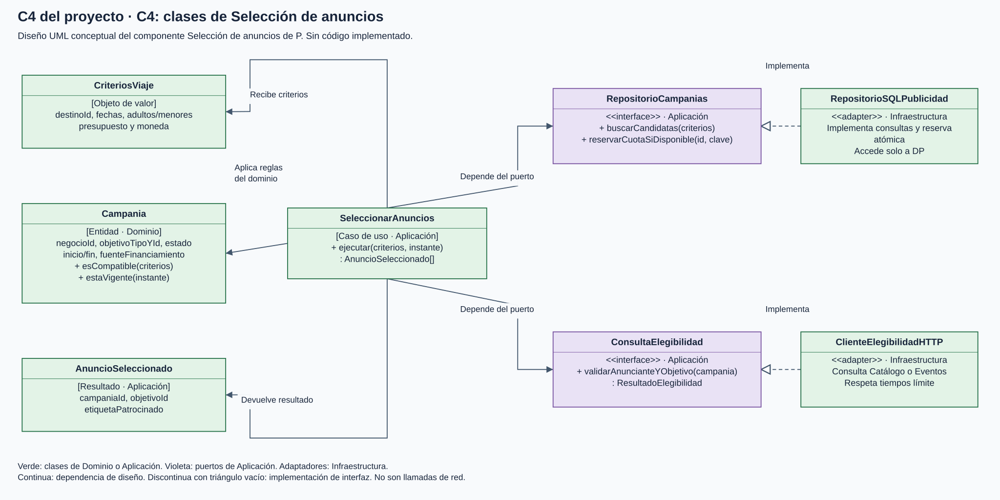
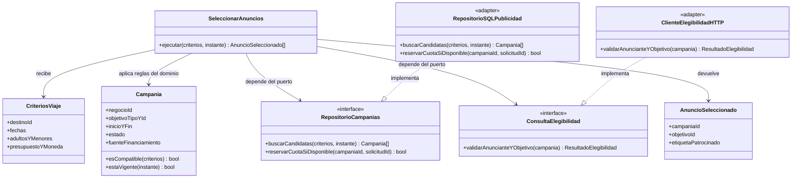

# C4 del proyecto: C4, diseño conceptual de Selección de anuncios

[Diagramas ampliables en navegador](diagramas/index.html) · [Archivo editable Draw.io](diagramas/LlegueYa-C4.drawio)

**Alcance:** componente Selección de anuncios del contenedor P, ampliado desde C3. **Público:** desarrollo. **Estado:** UML conceptual; no existe código implementado. Los nombres no aprueban lenguaje ni framework. Se muestra un componente representativo, no todas las clases del sistema.

**Leyenda:** caja = clase o interfaz UML; flecha continua = dependencia de diseño; línea discontinua con triángulo = realización de interfaz. Los puertos pertenecen a Aplicación y las entidades a Dominio; los adaptadores pertenecen a Infraestructura. Aquí las flechas no representan llamadas de red ni un modelo relacional. Las bases y los servidores se documentan en C2 y despliegue.

## Secuencia de responsabilidad

1. El caso de uso recibe criterios estructurados y obtiene campañas candidatas mediante RepositorioCampanias.
2. Aplica compatibilidad, vigencia y condiciones de beneficio gratuito o pago confirmado. Consulta la elegibilidad actual del anunciante y el objetivo mediante ConsultaElegibilidad.
3. Si no puede confirmar elegibilidad, omite la campaña. El repositorio reserva cuota de forma atómica e idempotente, usando una clave de solicitud que definirá el SDD.
4. Devuelve anuncios con etiqueta de patrocinio. La reserva de cuota no equivale a una impresión: la medición de entrega, impresión y clic usa contratos separados.

La implementación SQL accede exclusivamente a DP. ClienteElegibilidadHTTP delega según el tipo de objetivo a Catálogo o Eventos, con tiempos límite. Los casos de uso no importan esos clientes ni SQL. Asistente y Recomendaciones no modifican reglas publicitarias; mantienen alternativas orgánicas y precios estructurados.

Las políticas, beneficio único, revisión de pagos y contratación pertenecen al componente Gestión comercial de C3 y se especifican en [publicidad y gratuidad](../docs/04-especificacion-funcional/03-publicidad-y-periodo-gratuito.md). No se añade un segundo componente a este acercamiento C4.
