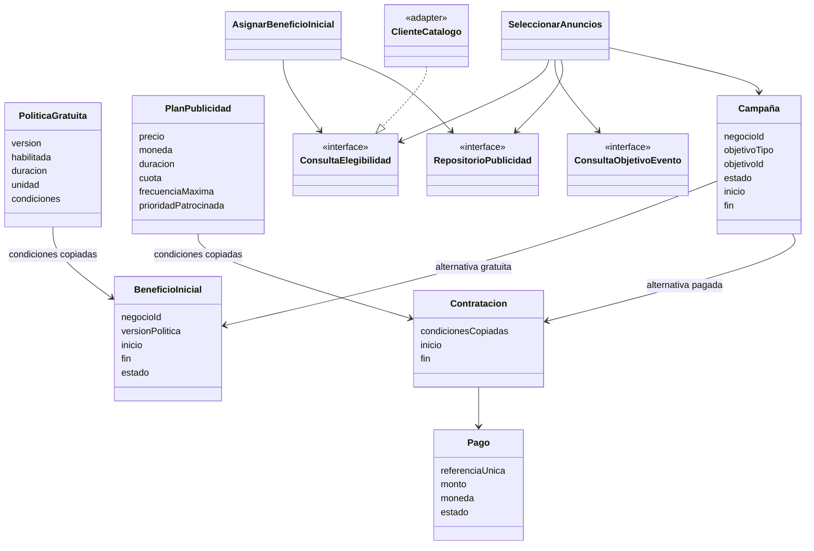

# Nivel 4 - Diagrama de código conceptual

Diagrama de diseño de Publicidad y planes; **no se desarrolla código**. Define entidades y puertos para periodo gratuito y anuncios con mayor alcance. Los nombres no fijan lenguaje ni framework.

Aplicación verifica el beneficio único por negocio y la política vigente al asignar; persistencia impone unicidad para evitar duplicados concurrentes. SeleccionarAnuncios aplica compatibilidad, vigencia, beneficio o pago, cuota y frecuencia. Los clientes de Catálogo y Eventos consultan por red al servicio dueño del objetivo; las entidades no conocen HTTP.

Los criterios del servicio Recomendaciones incluyen fechas, adultos/menores, moneda y presupuesto total o individual. Ese servicio calcula opciones compatibles antes de solicitar anuncios. Asistente etiqueta patrocinio y redacta con precios estructurados; no modifica reglas publicitarias.